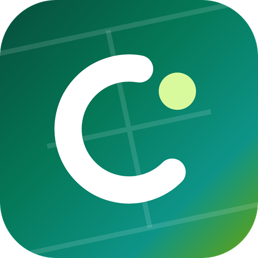

# Clubnetz

[English](README.md) · **Deutsch**

**Open-Source-Vereinsverwaltung und Platzbuchung für Tennisvereine.**

Mitglieder buchen Plätze in Sekunden. Der Vorstand verwaltet Mitglieder, Saisonen, Beiträge, Platzverkauf, Termine, Neuigkeiten, das Clubhaus und die Vereinsbuchhaltung an einem Ort. 
Kostenlos, selbst hostbar, auf jedem Handy installierbar, auf Deutsch und Englisch.

**Bereits gehostet und für Vereine kostenlos auf [clubnetz.app](https://clubnetz.app/de/)**

**Auf einen Blick:** rund 1.600 automatische Tests gegen eine echte PostgreSQL-Datenbank · jeder Text auf Deutsch und Englisch · über 300 Endpunkte, mit einer öffentlichen API für Vereine · ein Docker-Image, eine Datenbank

---

## 🎾 Was ist Clubnetz?

Clubnetz ist eine kostenlose Open-Source-Web-App für Tennisvereine und für jeden anderen Sportverein, der Plätze zu vergeben hat. Entstanden ist sie als Platzbuchung für einen Tennisverein. Inzwischen ist daraus eine vollständige Vereinsverwaltung geworden: Platzreservierung, Spielersuche, Mitgliedschaft, Platzverkauf an Nichtmitglieder, Vereinskalender, Neuigkeiten, die Clubhaus-Rechnung, die Vereinsbuchhaltung, Statistiken und ein wenig freundschaftlicher Wettbewerb.

Es gibt zwei Wege, Clubnetz zu nutzen:

- **Die gehostete Version.** Clubnetz läuft bereits auf **[clubnetz.app](https://clubnetz.app/de/)**, kostenlos für Vereine und Mitglieder. Schreibt an [hello@clubnetz.app](mailto:hello@clubnetz.app), und euer Verein bekommt einen eigenen Bereich. Ihr müsst nichts installieren und nichts warten.
- **Selbst hosten** mit Docker ([Anleitung auf Englisch](README.md#-hosting-it-yourself)).

Der Quellcode steht unter der Lizenz AGPL-3.0.

Eine Installation bedient viele Vereine. Jeder Verein ist ein eigener Mandant mit eigenen Plätzen, Saisonen, Mitgliedern, Rollen und E-Mail-Texten.

## ✨ Funktionen

### Für Mitglieder

| | |
|---|---|
| 🎾 **Platzbuchung** | Mit wenigen Klicks einen Platz buchen, mit Spielarten, Öffnungszeiten, Prime-Time-Regeln und Kontingenten je Saison. |
| 🔁 **Serienbuchungen** | Denselben Termin jede Woche oder alle paar Wochen reservieren. Einen einzelnen Termin oder diesen und alle folgenden ändern oder absagen. |
| 🤝 **Spielersuche** | Ihr sucht Mitspieler? Fragt ein paar Mitglieder oder eine eurer gespeicherten Gruppen für eine genaue Uhrzeit und eine Auswahl an Plätzen. Sobald der letzte Platz vergeben ist, bucht Clubnetz den ersten freien Platz. Solange ihr wartet, wird nichts blockiert. |
| 👨‍👩‍👧 **Familien** | Eltern buchen und verwalten für ihre Kinder. |
| 📅 **Vereinskalender** | Arbeitseinsätze, Feste, Turniere und Sitzungen, mit Anmeldung, Personenzahl und den Fragen der Organisatoren („2x Schnitzel, bitte“). Termine per Link oder WhatsApp teilen. |
| 📰 **Vereinsneuigkeiten** | Ankündigungen mit Anhängen, angepinnten Beiträgen und Ablaufdatum. |
| 📊 **Statistiken und Ranglisten** | Wer spielt am meisten, mit wem und wann. |
| 🏆 **Abzeichen und Trophäenschrank** | Abzeichen, die man sich über die Saison erspielt, und einmalige Abzeichen für besondere Erfolge. |
| 🗓️ **Abo-Planer** | Erstellt einen fairen Spielplan für gemeinsame Winterabos und exportiert ihn nach Excel. |
| ✨ **Saisonrückblick** | Ein Rückblick auf die eigene Saison im Story-Format (Stunden auf dem Platz, Partner, Abzeichen, Termine), freigegeben vom Verein. |
| 🔔 **Benachrichtigungen** | Neue oder abgesagte Buchung, Erinnerung vor dem Spiel, neue Termine, Neuigkeiten und Abzeichen. Per Push, per E-Mail oder gar nicht. |
| 💳 **Mitgliedschaft** | Einen Tarif für sich oder die ganze Familie wählen und den Beitrag online bezahlen. |
| 🍺 **Clubhaus-Rechnung** | Sehen, was im Clubhaus auf der eigenen Rechnung steht, und sie in der App mit SumUp bezahlen. |
| 📱 **Installierbare App** | Auf iOS, Android und am Computer auf den Startbildschirm legen. Mit hellem und dunklem Design. |

### Für den Vorstand

| | |
|---|---|
| 👥 **Mitglieder und Saisonen** | Mitglieder, Rollen (Admin, Sportwart, Kassier, Trainer, …) und die Anmeldung je Saison. |
| 💶 **Mitgliedsbeiträge** | Eure eigene Preisliste je Saison: Erwachsene, Jugend nach Jahrgang, Paare, Familien, Studierende, kostenlose Tarife und mehr. Mitglieder wählen ihren Tarif und bezahlen online mit Karte oder SEPA-Lastschrift (Stripe, direkt auf das Konto des Vereins) und sind damit automatisch freigeschaltet. Der Kassier sieht, wer bezahlt hat, trägt Überweisungen und Barzahlungen ein und exportiert die Liste nach Excel. |
| 🎟️ **Platzverkauf** | Freie Platzzeit an Mitglieder verkaufen, die in der Saison nicht angemeldet sind, mit Preisen je Platz, Wochentag und Uhrzeit. Sie bezahlen online (Stripe) oder mit einem Buchungsguthaben, das ihnen der Verein gibt. Angemeldete Mitglieder buchen weiter kostenlos. |
| 🧭 **Planer** | Sportwarte planen Turniere auf einer Zeitleiste über mehrere Tage: Buchungen per Ziehen verschieben und in der Länge ändern und viele Termine auf einmal buchen. Trainer und Vorstand können für jedes Mitglied buchen, ohne selbst mitzuspielen. |
| 🏟️ **Plätze und Spielarten** | Plätze, Öffnungszeiten, Prime Time, Buchungsregeln und wer was buchen darf. |
| 🚧 **Platzsperren** | Plätze für Turniere, Wartung, Wetter oder das wöchentliche Training sperren. Betroffene Spieler werden informiert. |
| ✉️ **E-Mail-Vorlagen** | Jede Vereins-E-Mail je Sprache anpassen, mit Markdown und Variablen, Live-Vorschau und Testversand. |
| 📣 **Aussendungen per E-Mail** | Neuigkeiten an alle Mitglieder, die aktive Saison, die Jugend oder einzelne Rollen senden. |
| 📈 **Vereinsstatistik** | Auslastung der Plätze und Aktivität über die Saison. |
| 📒 **Buchhaltung** | Die Bücher des Vereins: Rechnungsjahre, Einnahmen und Ausgaben aufgeteilt nach Kategorie, steuerlichem Bereich und Kostenstelle, Umbuchungen zwischen Konten, Belege direkt mit dem Handy fotografiert, Auswertungen, Excel-Export und ein druckbarer Jahresabschluss. Die Rolle Rechnungsprüfer prüft jedes abgeschlossene Jahr und bestätigt die Prüfung. |
| 🏦 **Automatische Buchungen und Bankimport** | Mitgliedsbeiträge, Platzverkauf, Clubhaus-Tage sowie Stripe-Gebühren und -Auszahlungen werden automatisch gebucht oder zur Prüfung vorgeschlagen. Kontoauszüge (camt.053, MT940, CSV, auch die Exporte von ELBA und Volksbank) importieren und jede Zeile mit einem Klick oder mit eigenen Regeln zuordnen. |
| 🧾 **Rechnungen** | Rechnungen an Mitglieder, Sponsoren oder andere Vereine als PDF mit Zahlungs-QR-Code („Zahlen mit Code“), per E-Mail versendet, mit Zahlungserinnerungen. Eine bezahlte Rechnung wird gebucht, das PDF ist der Beleg. |
| 🍻 **Clubhaus** | Die Strichliste des Wirts, nur digital. Offene Rechnungen, wer heute spielt und die Stammgäste sind einen Tipp entfernt, eine Runde ist in Sekunden gebucht, bezahlt wird bar, mit Karte oder von Mitgliedern in der App mit SumUp. Das Geld geht an den Wirt, Clubnetz führt nur die Liste. |
| 🔑 **API-Schlüssel** | Eigene Skripte und Werkzeuge mit dem Verein verbinden, nur lesend oder lesend und schreibend, mit einer [OpenAPI-Referenz](https://clubnetz.app/de/docs/api/). Zahlungen, Preise und die Buchhaltung sind mit einem Schlüssel nie erreichbar. |

### Immer dabei

- **Mandantenfähig** – die Daten jedes Vereins sind von denen der anderen getrennt.
- **Deutsch und Englisch** – jede Seite, jede E-Mail und jede Benachrichtigung.
- **Datenschutz** – Mitglieder können ihre Daten selbst exportieren, einen Verein verlassen und ihr Konto löschen. Impressum und Datenschutzerklärung sind enthalten.
- **Abgesichert** – Kontosperre nach Fehlversuchen, Rate Limiting, strenge Content Security Policy und Security-Header.

## 🛠️ Für Entwicklerinnen und Entwickler

Technik, lokale Einrichtung, Hosting mit Docker, Projektstruktur und die Hinweise zum Mitmachen stehen in der [englischen README](README.md):

- [Tech stack](README.md#-tech-stack)
- [Getting started](README.md#-getting-started)
- [Payments (optional)](README.md#payments-optional)
- [Clubhouse payments with SumUp (optional)](README.md#clubhouse-payments-with-sumup-optional)
- [Hosting it yourself](README.md#-hosting-it-yourself)
- [Project structure](README.md#-project-structure)
- [Contributing](README.md#-contributing)

Fehler und Ideen könnt ihr auch auf Deutsch als [Issue](https://github.com/sleepwalkerffs/Clubnetz/issues/new/choose) melden.

## 📄 Lizenz

Clubnetz ist freie Software unter der [GNU Affero General Public License v3.0](LICENSE).

Kurz gesagt: Ihr dürft Clubnetz nutzen, verändern und hosten, auch kommerziell. Wenn ihr es weitergebt oder eine veränderte Version über ein Netzwerk anbietet, müsst ihr den Quellcode eurer Version unter derselben Lizenz zugänglich machen.

---

Mit 🎾 gemacht für Vereine, die lieber spielen als Papierkram erledigen.

